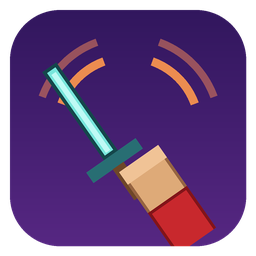
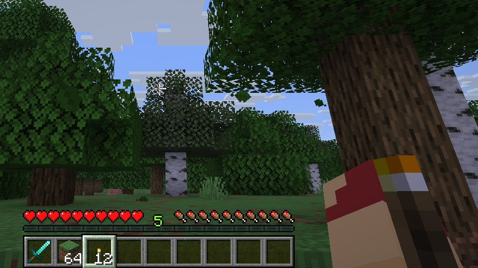
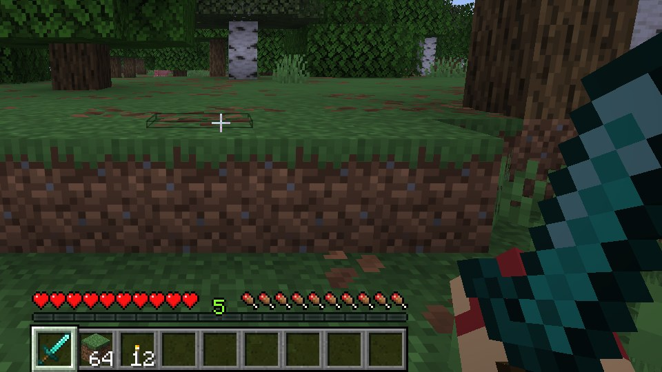

<p align="center"></p>

# Living Hands (Horizon mod)

Your first-person hands come alive. Held items bob with your steps, drop into a sprint, dip when you land and lift
when you jump, and breathe while you stand still. You stroke through water, climb a ladder hand over hand and trail
your arms on an elytra. Food is chewed, a drawn bow trembles, a shield is pushed out, a hit knocks your hand back and
a new item flips in. A punch jabs, a sword cuts across, a spear thrusts, a tool chops and a mace slams. Everything
moves on springs, so it eases in and settles back instead of snapping, and every effect has its own strength.

Your own arm, with your skin, holds what you carry: the game shows it only for an empty hand.

<p align="center"> </p>

Client side only: it works in single player and on any server, and the server never knows.

Pairs with [Living Camera](https://github.com/selfmonoraque5/living-camera): Living Camera already makes the held
item lag behind fast turns, so Living Hands' own **Turning sway** starts off. Without Living Camera, turn it on.

## Effects

| Effect | What it does | Default |
|---|---|---|
| Walking bob | The hand sways side to side and dips in step with your walking; crouching lowers it | 100% |
| Sprint pose | Weapons and tools are carried low and tilted while sprinting; anything else drops a little | 100% |
| Jump and landing | The hand lifts as you jump and dips on landing, deeper for harder landings, then springs back | 100% |
| Punch and swing | On top of the normal swing: a fist jabs, a sword cuts across, a trident or spear thrusts, an axe, pickaxe, shovel or hoe chops down, a mace lifts high and slams, a shield bashes | 100% |
| Breathing | A slow rise and fall while standing still | 100% |
| Eating, bows, shields | Food and drink are chewed; a bow, crossbow or trident is drawn back and trembles when held drawn; a raised shield is pushed out in front | 100% |
| Swim, climb, glide | A breaststroke in water, hand over hand on ladders and vines, arms trailing on an elytra | 100% |
| Hurt flinch | Taking damage knocks the hand down and twists it, harder for bigger hits | 100% |
| Item switch flip | A new item comes in with a little flip | 100% |
| Turning sway | The hand lags behind fast turns, then catches up | OFF |
| Arm with items | Your arm, with your skin, holds the item (not maps, which already show arms, or while invisible) | ON |

Torches and lanterns are held a little higher, to see by. Maps, compasses, clocks and the spyglass are carried
steadier.

## Settings

Options > Mods > Living Hands > **Config**. Each button steps through its values.

- **Living Hands**: ON / OFF, everything at once.
- **Overall intensity**: scales every effect (OFF, 50% to 200%).
- One strength per effect (OFF, 50% to 200%).
- **Arm with items**: ON / OFF.

## Install

1. Download `living_hands-1.0.0.hmod` from the [latest release](https://github.com/selfmonoraque5/living-hands/releases/latest).
2. Put it in the `horizon-native-mods` folder of your game folder, not in `mods`. On Windows that is
   `%APPDATA%\horizon\horizon-native-mods`.
3. In the launcher, open the Mods page and click **Build**. When it says **Up to date**, play.

Made for Horizon **Nightly 2026-11-22 · 2b77287**. The arm needs one small game patch (see below), so it builds only
on that exact Nightly.

## The game patch

The mod API lets a mod draw a model in the hand (`render_hand`), but doesn't say which texture is your skin. So the
mod patches the start of the game's own `hand_geometry` (`src/mixins/skin.rs`) to read your skin, whether your model
is slim, your main hand and whether you're invisible. It changes nothing the game does. Everything else uses the mod
API. A later Horizon that changes `hand_geometry` needs an update; an API for this is requested in
[horizon#19904](https://github.com/horizon-rust/horizon/issues/19904).

## Credits and licence

Written from scratch for Horizon, inspired by first-person animation mods such as Punchy! and Hold My Items. It
contains none of their code, animations or assets. MIT licence, see [LICENSE](LICENSE).

## Building

```sh
cargo test                  # the motion, the swings and the settings
cargo horizon-mod build     # target/horizon-mod/living_hands.hmod
```

| File | What it holds |
|---|---|
| `src/hands.rs` | The settings, the springs and the pose for each hand |
| `src/lib.rs` | The hooks: the player each tick, the frame time, and the hand |
| `src/arm.rs` | Your arm under the held item |
| `src/mixins/skin.rs` | The game patch: which skin your arm wears |
